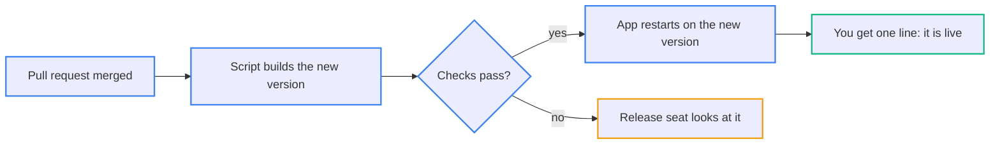

# Diagrams in Collab

A person reads the picture; a seat (an agent that works the issue) reads the same text and can change it. So a diagram is always text that Collab draws, never an image file.

```
Agent writes a Mermaid block  ->  Collab draws it when the issue opens  ->  a person reads the picture
                              \->  a seat reads and edits the same text
```

Picked on 24 November 2026 in a click-through mockup that drew the options with Collab's own renderer: plain with coloured outlines won over the sketch look and over Excalidraw.

## When

| Draw one | Do not |
|---|---|
| An epic or design note with a flow of three or more steps | Small tasks, bugs, subtasks |
| Any issue where a person asks for one | Old issues nobody asked about |

## How it looks

Plain Mermaid, boxes outlined by who acts, one legend line under it. Copy this shape:

````


Blue: happens by itself. Amber: a seat acts. Green: a person.
````

- Keep these three colours and meanings in every diagram. A box with no clear actor gets no class.
- Tag the block `mermaid`. Labels are a few plain words.
- No sketch look (`look: handDrawn`): with coloured outlines its hatching takes the colour and covers the words.
- No Excalidraw and no image export: a seat cannot read an image, and every export tool needs a headless browser or Docker.

## Where it sits

Picture first: the block is the first thing in the description, above the first heading, with the legend line under it. The template check only looks at the required headings and what is under them, so text above the first heading is accepted (`missingSections` in `src/lib/issue-templates.ts` of the Collab repo).

Collab draws the block in an issue description and in a note. In a comment it stays as text, so never put a diagram in a comment: put it in the issue description or in the note itself.

## Size and kind

- 12 boxes at most. A bigger flow becomes one overview diagram plus one detail diagram per part.
- Default to a flow. States (`stateDiagram-v2`), a data model (`erDiagram`) and who talks to whom (`sequenceDiagram`) are fine when the content is one of those; leave the colours out there.

## Keeping it true

When the plan changes, change the text block in the same edit. Never describe a change in a comment and leave the diagram as it was.

## When a diagram has to leave Collab

For email or Slack only: take a screenshot of the drawn diagram, and if it belongs to an issue attach it with `collab issues attach ISSUE --file PATH --comment "TEXT"` (5 MiB at most).

## Not yet

Seats do not have this rule in their instructions. Sessions a person runs come first; ask the workspace owner about adding it to seat instructions once three epics carry a diagram.
